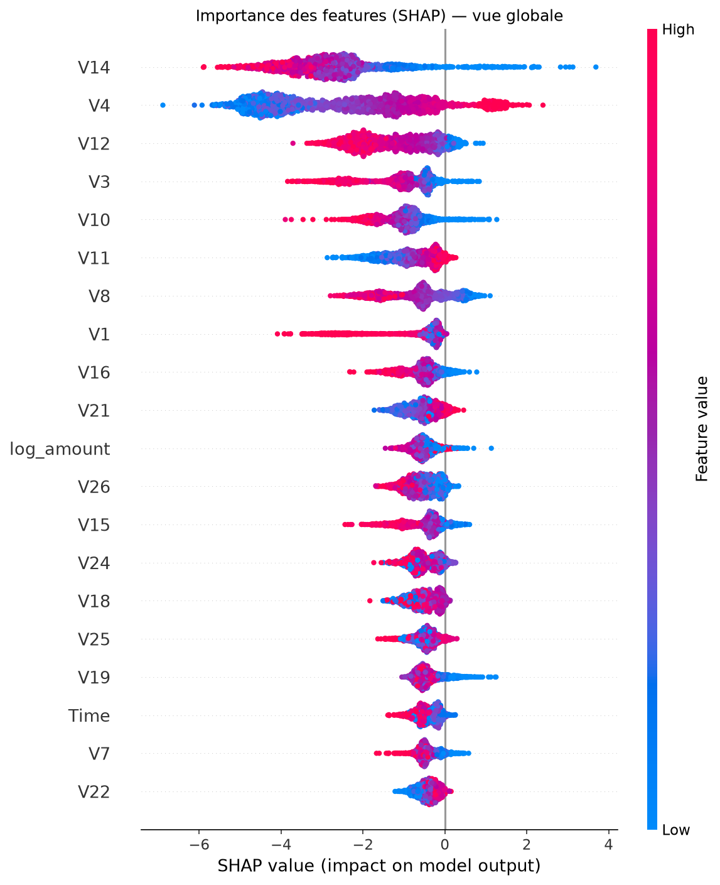
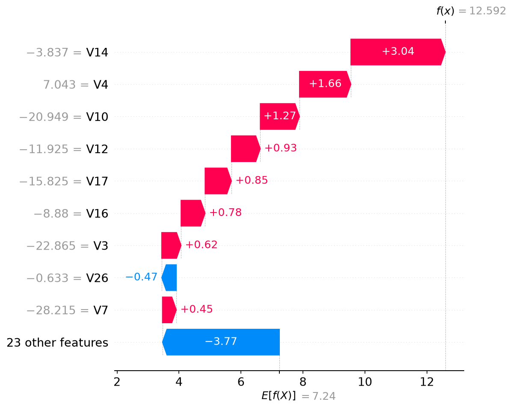

# Détection de fraude bancaire par Machine Learning

Pipeline complet de détection de fraude bancaire : exploration des données, feature engineering, gestion du déséquilibre de classes, modélisation XGBoost, explicabilité SHAP, et déploiement via une API FastAPI conteneurisée avec Docker.

## Résultats clés

| Métrique           | Valeur (test set)              |
| ------------------ | ------------------------------ |
| PR-AUC             | 0.879                          |
| ROC-AUC            | 0.982                          |
| Recall (fraude)    | 0.88 (86/98 fraudes détectées) |
| Precision (fraude) | 0.72                           |
| Fausses alertes    | 33                             |

Le seuil de décision (0.03) a été optimisé pour minimiser un coût métier estimé (coût d'une fraude ratée = 100, coût d'une fausse alerte = 5), plutôt que d'utiliser le seuil par défaut de 0.5.



## Architecture du pipeline

Transaction brute (Time, Amount, V1-V28)
↓
Feature Engineering (Hour, is_night, log_amount)
↓
Standardisation (StandardScaler)
↓
XGBoost (tuné via RandomizedSearchCV)
↓
Probabilité de fraude + décision (seuil optimisé)

## Stack technique

- **Données** : Credit Card Fraud Detection (Kaggle, ULB) — 284 807 transactions, 0.17 % de fraudes
- **ML** : scikit-learn, imbalanced-learn, XGBoost
- **Explicabilité** : SHAP
- **API** : FastAPI, Pydantic
- **Déploiement** : Docker
- **Tests** : pytest

## Structure du projet

fraud-detection/
├── notebooks/ # Exploration et expérimentations (EDA, comparaison de modèles, tuning, SHAP)
├── src/
│ ├── features.py # Feature engineering et preprocessing
│ ├── train.py # Entraînement complet reproductible
│ ├── evaluate.py # Réévaluation du modèle sauvegardé
│ └── api.py # API FastAPI
├── tests/ # Tests unitaires (pytest)
├── models/ # Modèle entraîné, seuil, graphiques SHAP
├── Dockerfile
├── requirements.txt # Environnement complet (dev + notebooks)
└── requirements-api.txt # Dépendances minimales pour l'API (production)

## Comment lancer le projet

### 1. Installation

```bash
python -m venv .venv
.venv\Scripts\Activate.ps1   # Windows
pip install -r requirements.txt
```

### 2. Télécharger les données

Le dataset [Credit Card Fraud Detection](https://www.kaggle.com/mlg-ulb/creditcardfraud) (Kaggle) doit être placé dans `donnees/creditcard.csv`.

### 3. Entraîner le modèle

```bash
python -m src.train
```

Reproduit l'intégralité du pipeline : split, feature engineering, entraînement XGBoost, choix du seuil, sauvegarde dans `models/`.

### 4. Évaluer le modèle

```bash
python -m src.evaluate
```

### 5. Lancer l'API

```bash
uvicorn src.api:app --reload
```

Documentation interactive disponible sur `http://127.0.0.1:8000/docs`.

### 6. Avec Docker

```bash
docker build -t fraud-api .
docker run -p 8000:8000 fraud-api
```

## Démarche méthodologique

### Gestion du déséquilibre de classes

Avec seulement 0.17 % de transactions frauduleuses, l'accuracy est inutilisable (un modèle naïf prédisant toujours "normal" atteindrait 99.83 % d'accuracy). La **PR-AUC** (Precision-Recall AUC) a été retenue comme métrique principale.

Six combinaisons modèle × stratégie de rééchantillonnage ont été comparées en validation croisée stratifiée (5 folds) :

| Modèle        | Stratégie        | PR-AUC (CV)   | Temps |
| ------------- | ---------------- | ------------- | ----- |
| Random Forest | class_weight     | 0.844 ± 0.023 | 134s  |
| Random Forest | SMOTE            | 0.847 ± 0.028 | 675s  |
| Random Forest | undersampling    | 0.739 ± 0.030 | 2s    |
| XGBoost       | scale_pos_weight | 0.846 ± 0.020 | 19s   |
| XGBoost       | SMOTE            | 0.845 ± 0.023 | 30s   |
| XGBoost       | undersampling    | 0.742 ± 0.049 | 7s    |

**Conclusion** : SMOTE n'apporte pas de gain significatif par rapport à `scale_pos_weight` (écart non significatif au vu des écarts-types), tout en étant 20 à 35 fois plus lent à l'entraînement. `XGB_scale_pos_weight` a été retenu pour le meilleur compromis performance/vitesse. L'undersampling dégrade nettement la performance en réduisant trop le volume de données disponible.

### Tuning des hyperparamètres

`RandomizedSearchCV` (40 itérations, 5 folds) a amélioré la PR-AUC de 0.846 à 0.855 en validation croisée. Les meilleurs hyperparamètres (`max_depth=8`, `subsample=0.7`, `colsample_bytree=0.7`) sont cohérents sur les 5 meilleures configurations testées, suggérant une amélioration réelle plutôt qu'un artefact du tirage aléatoire.

### Choix du seuil de décision

Le seuil par défaut (0.5) n'est pas optimal lorsque le coût d'un faux négatif (fraude ratée) diffère de celui d'un faux positif (fausse alerte). Un coût métier a été défini (FN = 100, FP = 5) et le seuil optimal a été recherché sur des prédictions out-of-fold du train set (jamais sur le test), pour éviter toute fuite de données.

### Explicabilité (SHAP)

Les features les plus influentes identifiées par SHAP sont cohérentes avec l'analyse exploratoire initiale. L'explication individuelle (waterfall plot) permet de justifier chaque décision du modèle transaction par transaction — un prérequis dans le secteur bancaire, où les décisions automatisées doivent pouvoir être expliquées.



## Limites et pistes d'amélioration

- **Anonymisation des données** : les colonnes V1-V28 (issues d'une PCA) empêchent toute interprétation métier concrète des résultats SHAP, bien que la méthode reste rigoureuse statistiquement.
- **Dérive des données (concept drift)** : les patterns de fraude évoluent dans le temps ; un réentraînement périodique serait nécessaire en production.
- **Validation temporelle** : un split stratifié aléatoire a été utilisé ; un split purement temporel (entraînement sur le passé, test sur le futur) serait plus représentatif d'un déploiement réel.
- **Monitoring** : aucun système de surveillance des performances en production n'a été mis en place (à envisager : suivi de la distribution des prédictions, alertes en cas de dérive).

## Licence

Ce projet est réalisé à des fins d'apprentissage et de démonstration.
